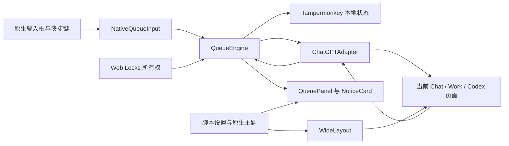

# ChatGPT Queue 架构

本文描述 1.8.0 的实现边界，更新于 2026-10-10。当前工作环境、证据日期与剩余任务见 [CONTEXT.md](CONTEXT.md)，选择原因见 [ADR](adr/README.md)。

## 开发与运行边界

源码入口是本 Git 根目录的 `firefox-chatgpt-toolkit/userscripts/chatgpt-queue`。`build.cjs` 将本地模块与 CSS 组装为同目录 `chatgpt-queue.user.js`，用户将完整产物安装到 Firefox Tampermonkey。

队列运行依赖已安装脚本、当前 ChatGPT 页面、GM 存储和浏览器 Web Locks。可选的问答归档通过 GM_xmlhttpRequest 连接 Obsidian Local REST API 和 OpenAI 兼容分类接口。Native Firefox 自动化与后台截图模块用于开发验收；Node.js/jsdom 用于构建和本地测试，均不是日常运行依赖。

## 信息归属

| 位置 | 负责的信息 | 主要边界 |
| --- | --- | --- |
| [src/core.cjs](../userscripts/chatgpt-queue/src/core.cjs) | 待发条目、active、暂停、持久化、回执恢复与错误 | 不依赖真实 DOM，通过 adapter 获取页面状态 |
| [src/browser.js](../userscripts/chatgpt-queue/src/browser.js) / ChatGPTAdapter | 原生编辑器、消息标识、模式、发送与完成信号 | 将前端差异转换为 snapshot、receipt、write、send |
| 同文件 / NativeQueueInput | 入队、原生草稿、条目编辑 | 入队成功才清空原生输入；编辑失败保留可恢复状态 |
| 同文件 / bootQueue | 路由绑定、GM 键、Web Locks、导航和事件监听 | 当前模式与会话的拥有者才能调度或截获输入 |
| 同文件 / QueuePanel、QueueSettings、WideLayout | 队列展示、设置、主题和容器宽度 | Shadow DOM 承载自有 UI；原生 composer 不被替换 |
| [src/notice-card.js](../userscripts/chatgpt-queue/src/notice-card.js)、[src/queue.css](../userscripts/chatgpt-queue/src/queue.css) | 可复用圆框卡片与样式 | 卡片机制不负责判断消息发送结果 |

## 一条消息的生命周期

1. 从原生 composer 捕获文字，保存到 items；保存失败不发送。捕获后清空原生草稿，调度等待页面就绪。
2. 当前回答完成且状态稳定、composer 为空、没有附件或页面错误时，保存 active 的准备阶段与发送前用户消息基线。
3. 通过原生编辑器状态写入，等待网页提交处理器同步，再次核对上下文，保存 submitting 阶段后点击 Send。
4. 新用户消息标识与正文匹配后确认接收。条目立即从 items 移除，active 继续记录当前回合。此时列表可能为空，但回答仍在运行。
5. 当前回合完成且状态稳定后清除 active，才调度下一条。任何无法确认的发送结果进入 coded fault，停止自动发送。

刷新后的 engine 默认暂停。恢复逻辑核对已保存的 active 与页面回执：已经接收的条目不因刷新再次发送；重新检测只读回执。详见 [ADR 0003](adr/0003-receipt-active-errors.md)。

## 页面适配与所有权

Chat、Work 和 Codex 共用调度引擎，前端差异集中在 adapter。Work 只将当前任务 `data-talvt-turn-state=complete` 视为完成；Codex 使用当前最终回答结构及 Copy/Rate 控件。Stop/streaming 优先于保留的完成控件。页面没有就绪的 composer、切换上下文或出现失败状态时不能发送下一条。

状态按模式与会话保存；只有一个标签页持有该状态键的 Web Lock。导航时先废止旧 owner，之后绑定新模式与会话。临时新聊天标识不等同真实会话 ID，临时队列仅在同模式建立真实会话后迁移。详见 [ADR 0004](adr/0004-state-and-ownership.md) 和 [ADR 0005](adr/0005-work-codex-adapters.md)。

## 问答归档

[archive-dom.js](../userscripts/chatgpt-queue/src/archive-dom.js) 定位回答的原生操作栏、对应问题和回答版本，识别 Chat/Work/Codex 完成状态，并转换 Markdown。点击按钮时冻结一问一答快照；后续页面更新不改变这次预览的正文。

[archive-core.cjs](../userscripts/chatgpt-queue/src/archive-core.cjs) 负责路径和标签规则、Markdown 笔记、目录/标签参考、AI 分类与保存协议。分类只发送本次问答、目录与标签。保存依次 PUT、GET 精确核对、持久化新路径，再删除属于同一归档的旧文件；未完成的旧路径清理保留在映射中供下一次保存继续执行。

[archive-browser.js](../userscripts/chatgpt-queue/src/archive-browser.js) 管理工具栏图标、三个可编辑预览字段、右上角通知、GM 请求与配置。用户编辑字段后，晚到的 AI 建议不会覆盖编辑；取消或导航使旧预览失效。配置键 `cq-accent-archive-config-v1` 和映射前缀 `cq-accent-archive-note-v1:` 独立于队列状态和全宽设置。API key 只保存在用户的 GM 配置中。

归档失败以 `[ChatGPT Archive][CODE]` 和 `chatgpt-archive:error` 事件报告，事件仅含错误代码。分类失败保留手动保存；保存失败保留预览。协议选择见 [ADR 0008](adr/0008-obsidian-rest-api.md)。

## 验证与数据

本地状态机测试检查发送、恢复和错误不变量；DOM/完整生成脚本测试检查页面信号、事件监听、原生输入复用及模式隔离。它们不能代替当前真实前端验收。带日期的 [VALIDATION.md](../userscripts/chatgpt-queue/VALIDATION.md) 与 `validation-*.json` 保留实际验证范围。

2026-10-09 的 Work/Codex 真实验收使用短文字 prompt 和合成 Ctrl+Q。新增模式的物理按键、完整工具/审批流程及其他 Codex URL/layout 未完整验证。迁移时的本地检查只证明新路径的工作环境，不把历史浏览器结果更新为今天的验证。

发布材料保留源码、许可证、测试及脱敏验收记录。GM 中的消息、私有截图、会话网址、草稿备份和一次性 Console 任务属于本地材料，归入忽略的 `.local/legacy-workspace` 或其他本地运行目录。旧 workspace 仅为备份；新源码入口由 [ADR 0007](adr/0007-workspace-source-authority.md) 确定。
